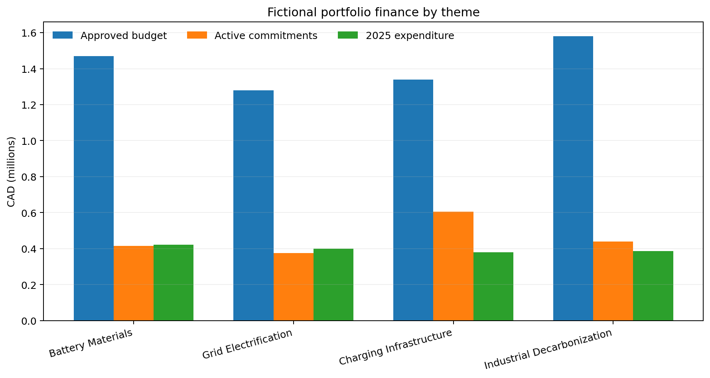
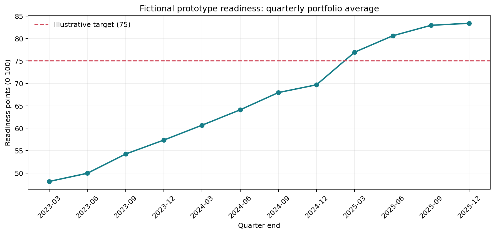
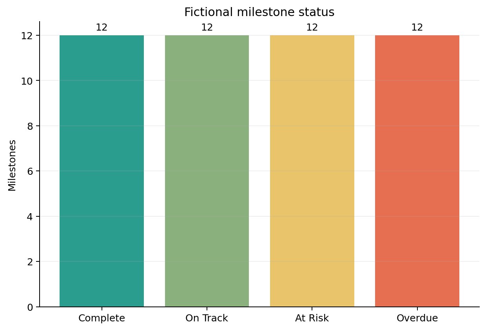
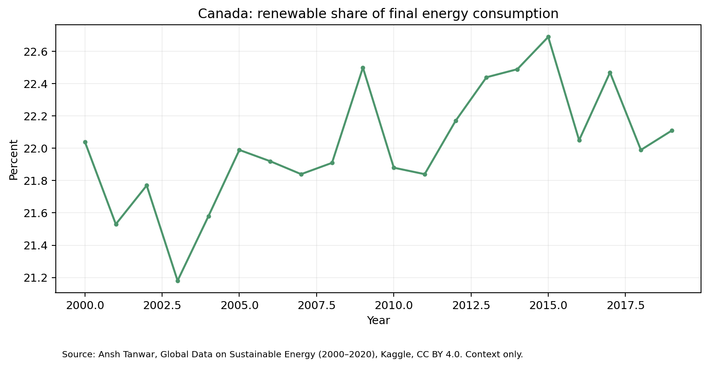

# Research Program Performance & Impact Reporting Dashboard

This portfolio project demonstrates a reporting workflow for a university research program focused on electrification, batteries and decarbonization. It brings finance, delivery, reporting, research outputs and selected public energy indicators into one documented model.

> **Demo data:** Every project, person, budget, expense, milestone, KPI value, submission, risk and research output in the operational files is fictional and generated for this project. It does not represent Volt-Age, a university, funder or real person. The public energy dataset is kept separate from those fictional records.

## What is in the repository

- Reproducible fictional operational CSV tables, generated with a fixed seed.
- An attributed Kaggle sustainable-energy dataset for separate country-level context.
- A field dictionary, KPI register, data model, quality rules, caveats and report design.
- Power Query M examples, DAX measure definitions and Power BI build instructions.
- Three PNG chart previews generated from the fictional tables.

## Questions the dashboard is designed to answer

1. How much approved funding has been spent, committed or left available?
2. Which projects and milestones need attention?
3. Are quarterly reports and KPI updates arriving on time?
4. What research outputs have been recorded, and how do selected public energy indicators vary by country and year?

## Project structure

```text
data/synthetic/       Fictional operational source tables
data/public/          Attributed public energy source
data/processed/       Reproducible validation summary
data/dictionaries/    Field and KPI definitions
docs/                 Model, quality, assumptions and report design
powerbi/              Power Query, DAX and Desktop build guide
reports/figures/      PNG chart previews
scripts/              Data generation, validation and chart scripts
```

## Run it

Requires Python 3.10 or newer. Chart generation uses Matplotlib.

```powershell
python -m pip install -r requirements.txt
python scripts/generate_demo_data.py
python scripts/validate_data.py
python scripts/create_charts.py
```

### PNG charts







These are static previews generated from the fictional operational tables, not screenshots of a live Power BI report.

### Public energy context (separate from the fictional program data)



## Power BI project

Open [ResearchImpact.pbip](ResearchImpact.pbip) in Power BI Desktop. It contains a semantic model with 15 tables and a four-page report for executive overview, finance and delivery, KPI and reporting health, and research/public context.

The model reads the CSV files from this public repository's `main` branch, so an internet connection is required to refresh. Set the web source credentials to Anonymous if prompted. The PBIP project format is a Power BI Desktop preview feature; enable **Power BI Project (.pbip) save option** under **File > Options and settings > Options > Preview features** if Desktop asks. To make a standalone `.pbix`, open the project and use **File > Save as**.

## Public data and attribution

The separate contextual source is *Global Data on Sustainable Energy (2000–2020)* by Ansh Tanwar, from [Kaggle, version 7](https://www.kaggle.com/datasets/anshtanwar/global-data-on-sustainable-energy/versions/7). The Kaggle page states CC BY 4.0. See [source attribution and reuse notes](docs/source_attribution.md). Country-level trends are context only; they are not program outcomes and cannot be attributed to a research program.

## Limitations

This is a demonstration model, not an audited finance system, grant-management system, impact evaluation or causal study. The fictional values show reporting logic only. A real deployment needs approved definitions, source reconciliation, privacy and access controls, stakeholder validation and a governed refresh process. Details are in [assumptions and limitations](docs/assumptions_and_limitations.md).

## Portfolio summary

> Built a reproducible research-program performance reporting prototype using fictional operational data, a documented star schema, Power Query transformations, DAX measure definitions, data-quality checks and attributed public energy context.
